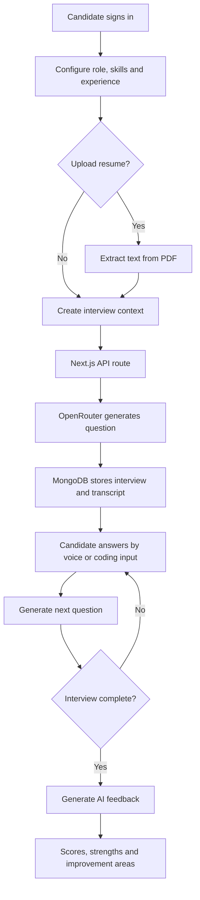

<div align="center">

# 🎯 AI Mock Interview

### Practice interviews. Speak with confidence. Improve with feedback.

An AI-powered mock interview platform that helps candidates prepare for technical interviews through role-focused questions, voice-based interaction, coding prompts, resume-aware questions, and AI-generated performance feedback.

<p>
  <a href="https://ai-mock-interview-vitap.vercel.app/"></a>
  <a href="https://github.com/ch-ankit679/ai-mock-interview"></a>
</p>

<p>
  
  
  
  
  
  
</p>

</div>

---

## 📌 Overview

Preparing for an interview takes more than memorizing answers. **AI Mock Interview** lets you practice in an interview-style environment: set a target role, list relevant skills and experience, optionally provide your resume, and respond to questions generated for your context.

During a session, the interviewer can speak its questions aloud while you answer using your microphone. The application can introduce coding questions with a dedicated code-entry panel. At the end, an AI-generated report summarizes your performance and highlights strengths and areas to improve.

> **Live application:** [ai-mock-interview-vitap.vercel.app](https://ai-mock-interview-vitap.vercel.app/)

## ✨ Features

- **Role-focused interview setup** — specify the job role, skills, and experience you want to practice.
- **Resume-aware questions** — upload a PDF resume so the interviewer can ask questions about your projects, skills, and experience.
- **AI-generated interview questions** — questions are generated in context using the OpenRouter chat-completions API.
- **Voice-based practice** — use browser speech recognition to provide spoken answers and browser text-to-speech to hear the interviewer.
- **Coding question flow** — respond to coding prompts through a dedicated code-entry interface.
- **Live webcam panel** — enable or disable your camera during the session; the camera preview can be repositioned on screen.
- **Interview transcript and timer** — follow the conversation and track the elapsed session time.
- **AI-generated performance report** — receive scores for technical knowledge, communication, and problem-solving, alongside overall feedback, strengths, and areas for improvement.
- **Authentication** — Clerk handles user sign-in and sign-up.
- **Persistent interview records** — MongoDB stores interview details, conversation transcripts, and generated feedback.
- **Responsive UI components** — built with Next.js, Tailwind CSS, and reusable UI components.

## 🧭 How It Works

1. **Sign in** to the application.
2. **Create an interview** by entering your target job role, skills, and experience.
3. **Optionally upload a PDF resume.** The text is extracted in the browser and provided as context for relevant questions.
4. **Start the session.** The app generates an opening question and presents it in the interview transcript.
5. **Answer questions** using your microphone when your browser supports speech recognition. You can also use the coding input when a coding prompt appears.
6. **Continue through the interview.** The application mixes general technical, coding, and—when a resume is provided—resume-related questions.
7. **Review the feedback report** for technical, communication, and problem-solving scores, strengths, and suggested improvement areas.

## 🛠️ Tech Stack

| Area | Technologies |
|---|---|
| Frontend | Next.js 15, React 19, TypeScript |
| Styling and UI | Tailwind CSS 4, Radix UI, reusable UI components, Lucide React |
| Authentication | Clerk |
| AI integration | OpenRouter API, using the `gpt-4o-mini` model in the current API routes |
| Database | MongoDB, Mongoose |
| Networking | Fetch API, Axios |
| Resume processing | PDF.js for extracting text from PDF resumes |
| Interview interaction | Browser Speech Recognition API, Web Speech Synthesis API, MediaDevices / webcam |
| Deployment | Vercel |

## 🏗️ Application Flow



## 🚀 Getting Started

### Prerequisites

Install the following before running the project locally:

- [Node.js](https://nodejs.org/) (an active LTS release is recommended)
- npm (included with Node.js)
- A [MongoDB Atlas](https://www.mongodb.com/atlas) cluster or another MongoDB instance
- A [Clerk](https://clerk.com/) application for authentication
- An [OpenRouter](https://openrouter.ai/) API key for AI question generation and feedback

### 1. Clone the repository

```bash
git clone https://github.com/ch-ankit679/ai-mock-interview.git
cd ai-mock-interview
```

### 2. Install dependencies

```bash
npm install
```

### 3. Configure environment variables

Create a `.env.local` file in the project root:

```env
# MongoDB connection string
MONGODB_URI=mongodb+srv://<username>:<password>@<cluster-host>/<database>?retryWrites=true&w=majority

# OpenRouter API key used by the interview and feedback API routes
OPENROUTER_API_KEY=your_openrouter_api_key

# Clerk authentication keys
NEXT_PUBLIC_CLERK_PUBLISHABLE_KEY=your_clerk_publishable_key
CLERK_SECRET_KEY=your_clerk_secret_key
```

Replace each placeholder with your own values. Configure the corresponding sign-in and sign-up URLs in your Clerk dashboard if your Clerk setup requires them.

**Keep secrets private.** Do not commit `.env.local`, database credentials, or API keys to Git. Only variables that must be exposed to browser code should use the `NEXT_PUBLIC_` prefix; never put private API keys under that prefix.

### 4. Start the development server

```bash
npm run dev
```

Open [http://localhost:3000](http://localhost:3000) in your browser.

### 5. Validate the build

Run the available checks before deploying:

```bash
npm run lint
npm run build
```

## ⚙️ Environment Variables

| Variable | Required for | Description |
|---|---|---|
| `MONGODB_URI` | Database access | MongoDB connection string used by Mongoose. |
| `OPENROUTER_API_KEY` | AI questions and feedback | API key used by the interview question and feedback endpoints. |
| `NEXT_PUBLIC_CLERK_PUBLISHABLE_KEY` | Authentication | Public Clerk publishable key used by the Clerk frontend integration. |
| `CLERK_SECRET_KEY` | Authentication | Private Clerk secret key used for server-side authentication. |

Add these variables to your local `.env.local` file and to the environment-variable settings for your deployment. Never publish real key values in the repository.

## ☁️ Deployment on Vercel

The project is connected to a Vercel deployment:

**[Open the live AI Mock Interview application](https://ai-mock-interview-vitap.vercel.app/)**

To deploy your own instance:

1. Import the GitHub repository into [Vercel](https://vercel.com/).
2. Add the environment variables listed above in the project's settings.
3. Ensure your MongoDB deployment accepts connections from the hosting environment, following MongoDB's security guidance.
4. Configure your production domain in Clerk's allowed origins and redirect settings.
5. Deploy and verify sign-in, interview creation, question generation, transcript persistence, and feedback generation.

## 🎙️ Browser Permissions and Compatibility

- Allow microphone access to use speech recognition.
- Allow camera access if you want to use the webcam preview. You can also turn the camera off during a session.
- Speech recognition availability varies by browser. Use a browser that supports the Web Speech API; if speech recognition is unavailable, the voice-answer workflow may not work as intended.
- The AI interviewer uses browser text-to-speech to read questions aloud. Audio behavior depends on browser and device settings.
- A working internet connection is required for hosted services such as Clerk, MongoDB, and OpenRouter.

## 🔐 Privacy and Responsible Use

- Resume text may be sent to the AI provider as context for interview question generation. Upload only a resume you are comfortable processing through the configured services.
- Store credentials in environment variables and restrict access to your database.
- Generated scores and feedback are intended for practice and self-improvement. They are AI-generated estimates, not an objective hiring decision or a guarantee of interview performance.

## 📁 Project Structure

```text
ai-mock-interview/
├── app/
│   ├── api/                 # Interview creation, question flow and feedback routes
│   ├── components/          # Header, interview setup and coding UI
│   ├── dashboard/           # Dashboard and interview session/feedback pages
│   ├── sign-in/             # Clerk sign-in route, if configured
│   ├── sign-up/             # Clerk sign-up route, if configured
│   ├── layout.tsx           # Root layout, Clerk provider and toast notifications
│   ├── page.tsx             # Landing page
│   └── globals.css          # Global styles
├── components/ui/            # Reusable UI primitives
├── lib/
│   ├── db.js                 # MongoDB connection helper
│   └── models/                # Mongoose models, including interview sessions
├── public/                   # Static assets and PDF worker
├── middleware.ts              # Clerk route protection
├── package.json              # Dependencies and npm scripts
└── README.md
```

> File names and routes may evolve as the project changes. See the repository for the current implementation.

## 🗺️ Potential Improvements

Possible future enhancements include:

- Interview history and progress analytics across multiple sessions.
- More configurable interview lengths and difficulty levels.
- Additional file formats for resume parsing.
- Automated tests for API routes and interview workflows.
- More detailed coding evaluation, such as execution against test cases.

## 🤝 Contributing

Contributions and suggestions are welcome. To propose a change:

1. Fork the repository.
2. Create a feature branch: `git checkout -b feat/your-feature`.
3. Commit your changes with a clear message.
4. Open a pull request describing the change and how you tested it.

## 📄 License

No license file is currently listed at the repository root. Add a `LICENSE` file if you intend to define permissions for others to use, modify, or redistribute this project.

---

<div align="center">
  <p><strong>Built to make interview practice more focused, interactive, and actionable.</strong></p>
  <p>⭐ If this project is useful to you, consider starring the repository.</p>
</div>
